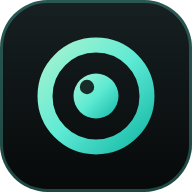
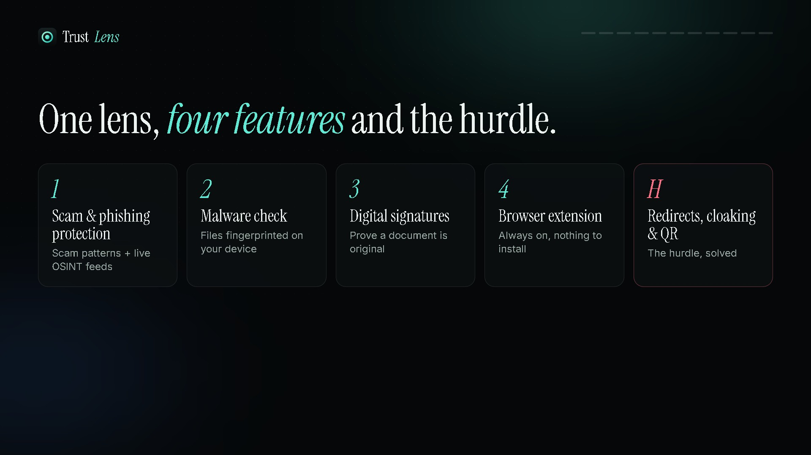
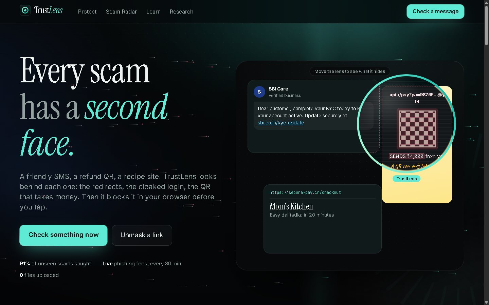
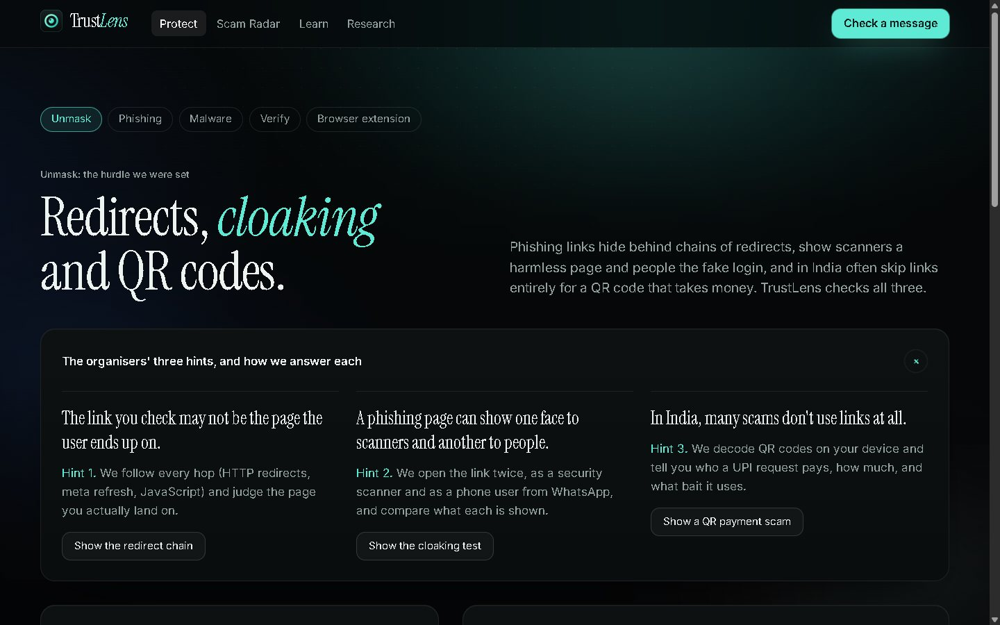
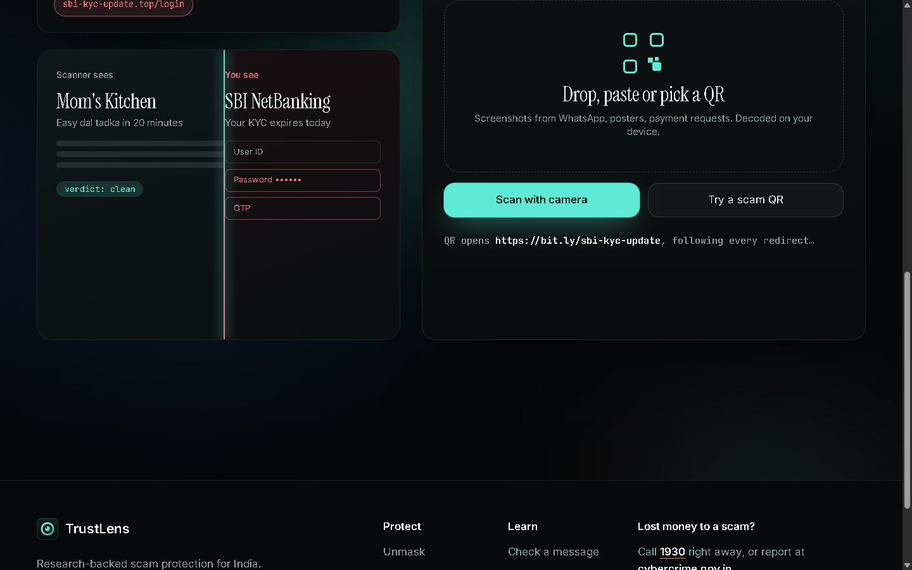
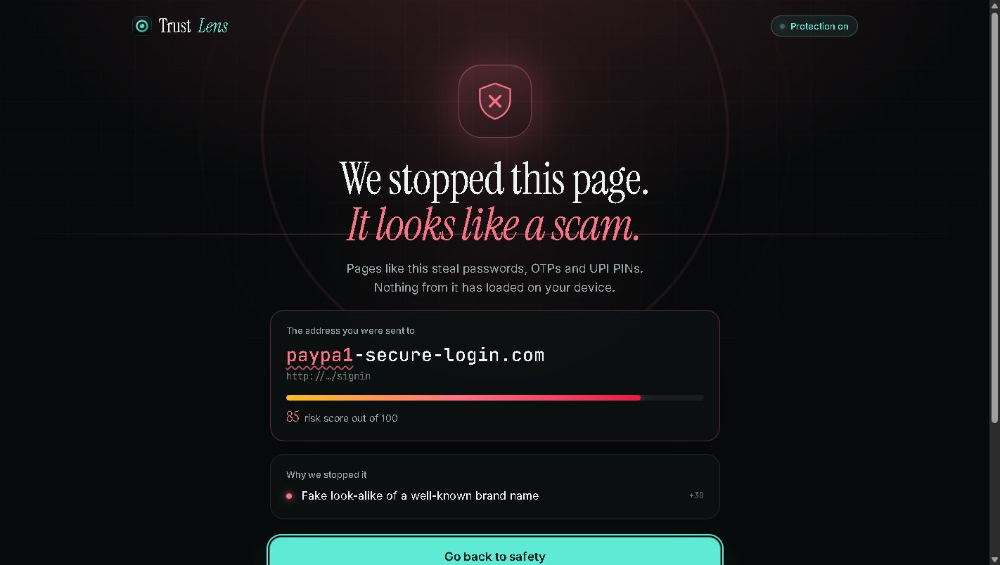
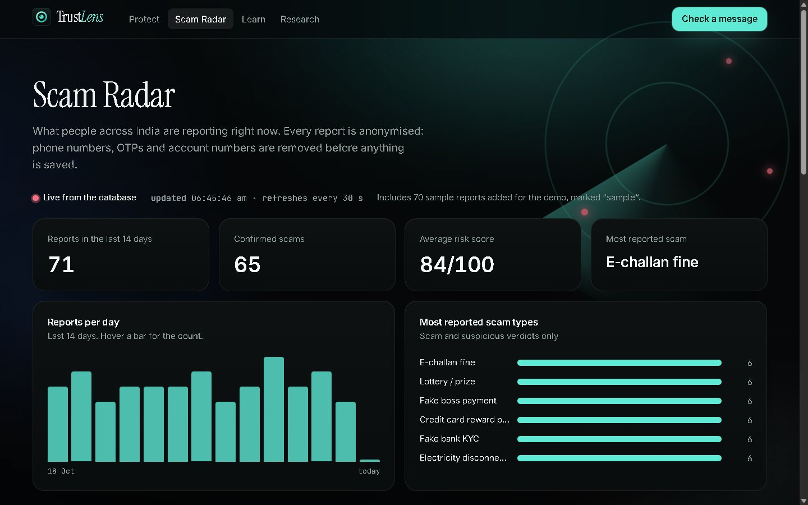
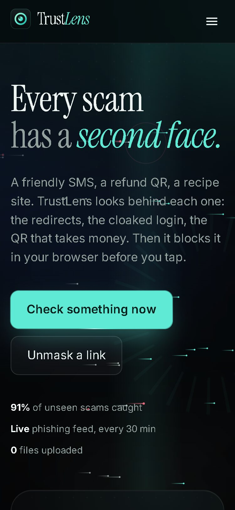
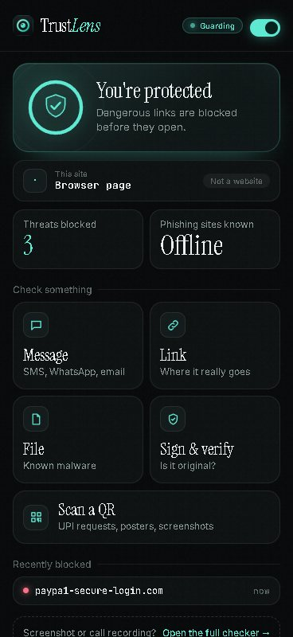
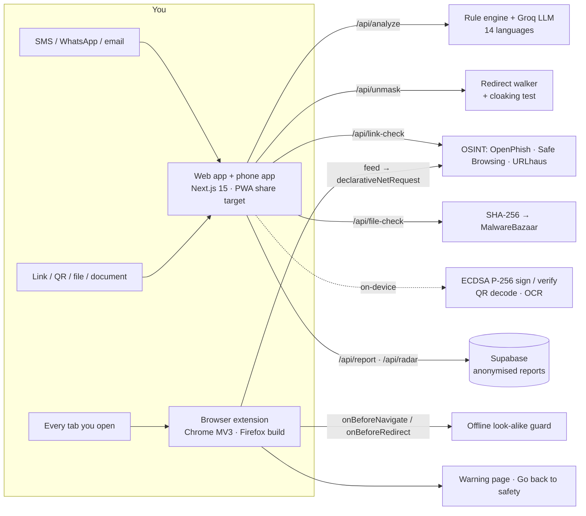

<div align="center">



# TrustLens

### Every scam has a second face. TrustLens shows it to you, before you tap.

A web app, a browser extension and a phone app that unmask phishing links, cloaked fake-bank pages, UPI QR scams, malware and forged documents, then explain every trick in plain words, in 14 Indian languages.

[](https://trustlens-psi-two.vercel.app)
[](docs/TrustLens_Showcase.mp4)
[](#tested-end-to-end)


**AfterHours 1.0** · Theme: *Trust, Privacy & Digital Provenance* · **Team Zenith (AH-54)**: Bipin A · Darshan HS · Manoj Bharadwaj · Kaushal Ved

<a href="docs/TrustLens_Showcase.mp4"></a>

*Click to watch the 90-second demo: a day with Priya, every feature in action on the live site.*

</div>

---

## Why this matters

Indians lost **₹22,845 crore** to cyber fraud in a single year (MHA, Lok Sabha 2025), with **36 lakh** cases reported in 2024. Almost all of it started with one message, one link or one QR code that **looked genuine**.

Scanners and spam filters fail because modern scams have a second face:

- the link you check **is not the page you land on**: it bounces through shorteners and trackers;
- the page shows **scanners a recipe blog** and **people a fake bank login**;
- the "refund" **QR code doesn't pay you**; it takes your money.

TrustLens is built to see that second face.

---

## What it does

| | Feature | How | Protects |
|---|---|---|---|
| **1** | **Scam & phishing protection** | Look-alike and brand-spoof detection (`paypa1`, `sbi-kyc-update.top`), live OSINT feeds (OpenPhish, Google Safe Browsing, URLhaus), a 0–100 risk score with **every reason named**. Messages, call recordings and screenshots are decoded too | **C**onfidentiality |
| **2** | **Malware & virus check** | The file is fingerprinted with **SHA-256 on your device** and matched against MalwareBazaar and a known-bad list. **The file is never uploaded** | **I**ntegrity |
| **3** | **Digital signature verification** | Sign a circular or certificate with **ECDSA P-256** in the browser; anyone can verify it. Change **one byte** and it shows **Tampered** | **I**ntegrity |
| **4** | **Always-on browser extension** | Blocks phishing **before the page loads**, catches look-alikes and **hidden redirects**, and "Go back to safety" returns you to where you were. Popup tools plus right-click checks | **A**vailability |
| **H** | **The hurdle: redirects, cloaking & QR** | Follows every redirect hop, runs a **cloaking test** (scanner vs. phone), and decodes **UPI QR requests**: who gets paid, how much, and the bait | all three |

Plus: **14 Indian languages** (Hindi, Hinglish, Tamil, Telugu, Bengali, Marathi, Kannada, Malayalam, Gujarati, Punjabi, Odia, Urdu, Assamese, English), a **live Scam Radar** of anonymised reports, and **practice lessons** on the 7 psychological levers every scam pulls.

<table>
<tr>
<td width="50%"><br><sub><b>X-ray lens.</b> Move the lens over a friendly SMS, a refund QR and a recipe site to see the scam underneath.</sub></td>
<td width="50%"><br><sub><b>Unmask.</b> 3 hidden hops (HTTP 302 → meta refresh → JavaScript) ending on a cloaked fake login.</sub></td>
</tr>
<tr>
<td><br><sub><b>QR scams.</b> "Receive your refund" actually <i>sends</i> ₹4,999 to a phone-number UPI ID.</sub></td>
<td><br><sub><b>Extension.</b> Blocked before it loads, every reason weighted, one tap back to safety.</sub></td>
</tr>
<tr>
<td><br><sub><b>Scam Radar.</b> Live, anonymised reports from across India.</sub></td>
<td align="center"> <br><sub><b>Phone & popup.</b> Installable app with Share → TrustLens; every check one click away.</sub></td>
</tr>
</table>

---

## The hurdle, solved

> *"Phishing links hide behind chains of redirects. Phishing pages show a harmless page to scanners and the fake login to real users. And in India, many scams arrive as QR codes that request money instead of sending it."*

| Hint from the organisers | TrustLens answer | Try it |
|---|---|---|
| *The link you check may not be the page the user ends up on.* | `/api/unmask` follows **HTTP 30x, `<meta refresh>` and JavaScript `location`** hops (up to 8), judges **every hop and the final page**. The extension also watches `webRequest.onBeforeRedirect`, so a scam reached through a redirect is blocked too | [`/unmask`](https://trustlens-psi-two.vercel.app/unmask) → *Show the redirect chain* |
| *A phishing page can show one face to scanners and another to people.* | The link is opened **twice**, as a security crawler and as an Android phone arriving from WhatsApp. It is flagged when people get a **password / OTP / PIN form** that the scanner never sees | *Show the cloaking test* |
| *In India, many scams don't use links at all.* | QR codes are decoded **on the device** (native `BarcodeDetector`, then jsQR at 4 scales, both polarities, plus a contrast pass). `upi://pay` requests show **payee, amount and bait words**; QR links go through the unmasker | *Show a QR payment scam* |

A built-in **demo lab** (`/lab/go`) gives judges a reliable two-faced page: 3 redirects ending on a fake SBI login that crawlers see as a recipe blog. It's clearly labelled, and nothing submits anywhere. Unmasking is **SSRF-safe**: only public http(s) hosts are fetched, DNS-checked on every hop, and private, loopback and cloud-metadata addresses are refused.

---

## How it works



**Privacy by design.** Files never leave the device (only their hash does). Signatures are created and checked in the browser. Phone numbers, OTPs and account numbers are **redacted before any AI call** or report. Shared text is never put in a URL. There are no accounts and no tracking.

---

## Use it

| Where | How |
|---|---|
| **Web** | [trustlens-psi-two.vercel.app](https://trustlens-psi-two.vercel.app): Protect → Unmask, Phishing, Malware, Verify, Extension; *Check a message* for texts, calls and screenshots |
| **Laptop browser** | [Download the extension](https://trustlens-psi-two.vercel.app/downloads/trustlens-chrome.zip) → unzip → `chrome://extensions` → Developer mode → **Load unpacked**. Works on Chrome, Edge and Brave |
| **Android** | Open the site in Chrome → **Install the TrustLens app** → long-press any link or QR in WhatsApp/SMS → **Share → TrustLens** |
| **Android, automatic blocking** | [Firefox build](https://trustlens-psi-two.vercel.app/downloads/trustlens-firefox.zip) (beta, loads through Firefox Nightly add-on debugging) |

Demo files for every feature (scam QR codes, a fake-malware sample, a signed circular plus its tampered copy, scam texts in 5 languages, screenshots, voice calls) are in the team's `Demo-Samples/` pack.

---

## Run locally

```bash
npm install
npm run dev            # http://localhost:3000
```

`.env.local`:

```bash
GROQ_API_KEY=...          # LLM + Whisper
SUPABASE_URL=https://<project>.supabase.co
SUPABASE_KEY=...          # publishable key
SAFE_BROWSING_KEY=...     # optional
ABUSECH_KEY=...           # optional: URLhaus + MalwareBazaar
```

Run `supabase/schema.sql` once in the Supabase SQL editor. The extension's popup talks to `http://localhost:3000` by default (change it under *Settings*).

```bash
node scripts/build-firefox.mjs && node scripts/pack-extension.mjs   # rebuild the download zips
```

---

## Tested end to end

Every push is checked against the **live deployment** with two suites:

```bash
node scripts/e2e.mjs https://trustlens-psi-two.vercel.app          # 35 API + route checks
node scripts/e2e-chrome.mjs https://trustlens-psi-two.vercel.app   # 82 real-Chrome checks, extension loaded
```

- Every page at **1440px and 375px**: no JS errors, no sideways scroll.
- Phishing, malware, sign → download `.sig` → verify the original → the edited copy shows **Tampered**.
- Unmask demo lab (3 hops, cloaking caught), 4 real QR images including a 140px one, both hint demos.
- Explanations generated in **Tamil, Punjabi and Urdu** script.
- **Extension in real Chrome:** blocks a look-alike; Go back returns to the previous page; a bad new tab is closed and its opener restored; a scam reached via server redirect is blocked; safe sites untouched; popup link/QR/file tools; on/off switch.
- SSRF guard: cloud-metadata and private addresses are refused.

Unit checks: `scripts/check-unmask.mts`, `check-qr.mts`, `check-intel.mts`, `check-signals.mts`, `check-redact.mts`, `check-guard.cjs`.

---

## Tech

**Next.js 15** (App Router, TypeScript, Tailwind v4) · **Groq** (Llama LLM + Whisper) · **Tesseract.js** OCR · **jsQR** + native `BarcodeDetector` · **Web Crypto** (SHA-256, ECDSA P-256) · **Supabase** (Postgres + RLS) · **Chrome MV3** (`declarativeNetRequest`, `webNavigation`, `webRequest`) · **PWA** share target · deployed on **Vercel** (Mumbai region).

<div align="center">

**TrustLens.** Look twice. Tap once.

Built in 24 hours at **AfterHours 1.0**, Don Bosco Institute of Technology, by **Team Zenith**.

</div>
